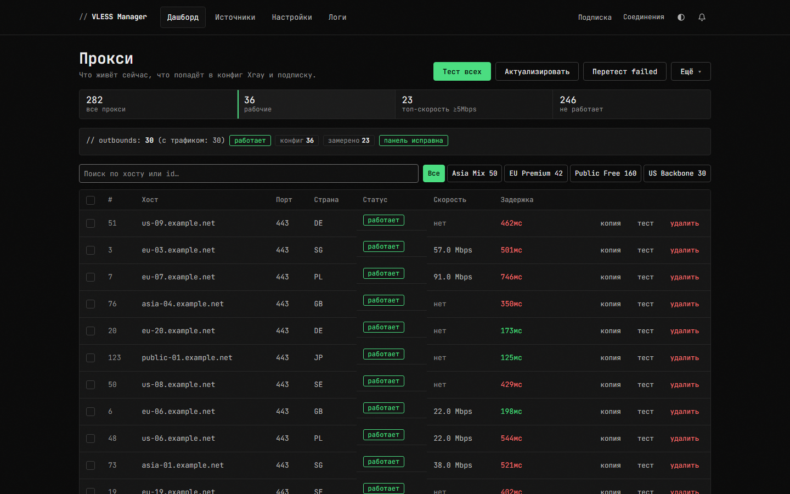

# VLESS Manager Proxy

[](LICENSE)
[](https://www.python.org/)
[](https://flask.palletsprojects.com/)
[](https://github.com/XTLS/Xray-core)

> **v4.0.1** — пересборка интерфейса: один верхний бар, компактная полоса фигур, таблица источников с выхлопом, состав конфига на первом экране, отдельная секция фильтра стран, мобильные карточки и доступные состояния. В 4.0.1 исправлен дубль списка на десктопе и убрано залипающее меню разделов настроек.



<sub>Дашборд v4.0.1. Страница источников — [docs/sources.png](docs/sources.png).</sub>

Веб-панель для управления VLESS прокси. Добавляй подписки и отдельные ссылки — панель проверяет каждый прокси через реальный запуск Xray: пачка профилей проверяется **одним процессом Xray** (свой inbound на профиль), мёртвые адреса отсекаются TCP-префильтром, пинг снимается сразу при проверке, и только потом топ-N рабочих замеряют скорость по одному. Конфиг Xray и подписка собираются по единому правилу — только свежие рабочие узлы, замеренные впереди — и применяются через Xray API. **Observatory + Balancer** (random, leastLoad, leastPing) автоматически выбирают лучший узел.

## Особенности

- **Единая политика допуска** — конфиг Xray и `subscribe.txt` собираются одним модулем (`app/selection.py`). Раньше у подписки и конфига были разные SQL-выборки, и они неизбежно расходились: «в конфиге есть, в подписке нет» и наоборот.
- **Один верхний бар и плотная композиция** — разделы текстом, действия страниц в шапке страницы, компактная полоса фигур, таблица на десктопе и карточки на телефоне; фильтр стран вынесен в отдельную секцию с названиями и счётчиками, а панель сохранения появляется только при несохранённых изменениях.
- **Только доказанно рабочие узлы** — `working` старше порога свежести (`profile_max_age_min`) не попадает ни в конфиг, ни в подписку; при заданном пороге скорости незамеренный профиль больше не считается «проходящим». Если строгие правила не дали никого — явный fallback с предупреждением в UI и логах, а не тихая подмена.
- **Стабильные теги outbound** — тег `node<id>` однозначно связан с профилем: hot-reload через Xray API добавляет/удаляет ровно изменившиеся узлы, а пересортировка после замера скорости не оставляет в работающем Xray старые адреса (раньше позиционные `node0, node1…` после пересортировки означали другие профили).
- **Оценка источников** — у каждого источника оценка 0–100, вердикт (основной / второй эшелон / мало рабочих / устарел / импорт не проходит) и рекомендация. Источники сортируются по приоритету, и незамеренные профили из лучших источников получают слоты раньше.
- **Актуализация** — кнопка «Актуализировать» перепроверяет и перезамеряет только профили, выпавшие из конфига по свежести или отсутствию замера, а не всю базу.
- **Прозрачный состав конфига** — страница «Источники» и `/api/config/preview` показывают, что попадёт в конфиг и подписку и почему остальные отсеяны (устарело, медленнее порога, без замера, страна исключена, битая ссылка).
- **Два фоновых таймера** — DB-only Check (только тест из БД) и Import+Check (импорт + enrich стран + тест). Import+Check имеет приоритет, не запускаются одновременно.
- **Быстрая проверка пачками** — Профили проверяются не процессом на каждый прокси, а пачкой в одном процессе Xray (`check_batch_size`, по умолчанию 64 пары inbound/outbound на процесс). Прогон упирается в сеть, а не в запуск процессов: на 1000 профилей это секунды-минуты вместо десятков минут.
- **TCP-префильтр** — До запуска Xray проверяется, открыт ли `server:port`: заведомо мёртвые адреса отсекаются за 1–2 с и не тратят таймаут пробы. Отключается в настройках (`tcp_prefilter`).
- **Строго поэтапный прогон** — Бизнес-логика импорта и замера разделена. Каждый прогон идёт по стадиям: **проверка работоспособности (сразу с медианой пинга) → замер скорости**. В UI видно, какая стадия идёт сейчас (степпер этапов) и сколько она длилась.
- **Эксклюзивность замеров** — Никогда не выполняется больше одного прогона/замера одновременно (общая блокировка): ручной тест одного прокси, «Тест всех», фоновые цепочки сериализуются. Это исключает параллельные замеры скорости, которые дают недостоверные данные.
- **Стадия 1 — работоспособность + пинг** — Профили проверяются HTTP-пробой (`generate_204`) через общий процесс Xray параллельно пачками. Есть ответ — профиль `working` с медианой из нескольких проб в `latency` (отдельная стадия пинга с новым запуском Xray больше не нужна), нет — `failed` с причиной (`timeout`, `tcp refused`, `tls error`, …).
- **Стадия 2 — speed test** — Топ-N рабочих (по пингу) замеряют пропускную способность **строго по одному профилю за раз**, каждый ровно фиксированное окно из настроек (`speed_test_min_sec`, по умолчанию 10 с). Рабочий URL замера запоминается на прогон (недоступный основной адрес не заставляет каждый профиль ждать полное окно), у стадии есть общий бюджет (`speed_stage_budget_sec`). Результат — primary сортировка в конфиге.
- **Импорт не запускает замер автоматически** — кнопки импорта только добавляют/обновляют профили; тест запускается отдельно («Тест всех» / «Перетест failed» / фоновая Import+Check).
- **Failover checker** — Фоновая проверка каждые 30 сек: если набор узлов в Xray расходится с отобранным по тегам (или hot-reload не удался), автоматически пересобирает конфиг. Сравниваются именно теги, а не количество: «то же количество» может скрывать другой набор узлов.
- **Backoff мёртвых профилей** — Упавший профиль получает паузу до следующей проверки (15 мин → 1 ч → 3 ч → 12 ч по числу падений подряд) и не тратит на себя каждый прогон; рабочий проверяется в каждом прогоне.
- **Auto-delete failed (осторожный)** — Автоудаление трогает только профили, упавшие трижды подряд, а не все `failed` после одного неудачного прогона.
- **Автоопределение страны** — Из фрагмента ссылки (`#RU`) или через ip-api.com батчами (до 100 адресов за запрос) в фоновом потоке: не держит блокировку замеров и не повторяет запросы по кэшу.
- **GeoSite-роутинг** — Настраиваемые правила (`geosite:ru-blocked`, `geoip:telegram`, ...) с направлениями direct/proxy.
- **Sniffing** — Настройка определения протоколов (HTTP, TLS, QUIC, FTP) с режимом route-only.
- **Фильтр по странам** — Выбор заблокированных стран; конфиг и подписка собираются только из разрешённых.
- **Import proxy** — Прокси для загрузки подписок (SOCKS5/HTTP) для обхода DPI/блокировок. Автоматический fallback на curl при ошибке urllib.
- **Диагностируемый импорт** — каждый источник получает статус (`ok`, `not_modified`, `empty`, `http_error`, `network_error`, `bad_url`) и причину; итог последней попытки хранится в БД и виден в списке источников.
- **Предохранитель по сети** — после двух сетевых сбоев подряд прогон перестаёт выжидать таймаут по каждому источнику: остальные помечаются пропущенными, прогон завершается за секунды и не держит эксклюзивную блокировку замеров.
- **Проверка связи** — пошаговая диагностика источника DNS → TCP → TLS → HTTP с подсказкой, что делать (указать прокси для импорта, заменить устаревший URL и т. п.).
- **Бюджет прогона** — общий лимит времени на импорт всех источников (90 с), чтобы импорт не блокировал UI и тесты.
- **Честные счётчики импорта** — «новых / уже было / без шифрования / удалено устаревших» вместо одного числа, которое росло и при повторной вставке.
- **ETag caching** — Пропуск неизменённых источников (HTTP 304) для ускорения повторных импортов; ключ кеша стабилен между перезапусками (sha1 от URL), учитывается и Last-Modified.
- **Stale cleanup** — При повторном импорте из источника удаляются прокси, которых больше нет в свежей подписке.
- **TXT-источники** — Импорт vless:// ссылок напрямую из текста (без URL).
- **Subscription URL** — `/api/subscribe.txt` для внешних клиентов (v2rayNG, Streisand, Hiddify).
- **Тест с отменой** — Фоновый тест можно отменить через UI.
- **SSE streaming** — Real-time прогресс тестов через Server-Sent Events.
- **Массовые операции** — Чекбоксы, выбор всех, удалить/протестировать выбранные.
- **Понятные причины отказов** — Для каждого failed-прокси хранится причина (timeout, connection refused, TLS и т.д.) и время последнего теста; отображаются прямо в списке.
- **Фильтр по причине отказа** — На дашборде можно отфильтровать failed-прокси по причине (включая «без причины») и карточки failed/failed<24h.
- **Перетест failed** — Кнопка «Перетест failed» запускает полный поэтапный прогон только для нерабочих прокси (без перепроверки рабочих).
- **Backup** — Экспорт/импорт настроек и источников в JSON.
- **Traffic stats** — Активные outbound и узлы с трафиком (без графиков).
- **Уведомления** — колокольчик в шапке на каждой странице: попап 9:16 только с предупреждениями (WARN) — тем, что реально пошло не так; счётчик непрочитанных хранится в браузере, внизу — ссылка на логи целиком (полный журнал со всеми уровнями).
- **Connections monitor** — Модалка со списком активных TCP-соединений через прокси (кто, куда, сколько байт, закрытие по одному или всех).
- **Анализатор соединений** — Per-IP группировка трафика, conntrack для per-connection байтов.
- **Прогресс тестов** — Прогресс-бар в реальном времени.
- **Performance recommendations** — API с реальными параметрами проверки, оценкой прогона по волнам и фактическими длительностями стадий последнего прогона.

## Конфигурация

Базовые параметры в `config.py`:

| Параметр | Значение | Описание |
|----------|---------|----------|
| `SOCKS_PORT` | 1080 | SOCKS5 inbound |
| `HTTP_PORT` | 1081 | HTTP inbound |
| `API_PORT` | 10085 | gRPC API Xray |
| `API_LISTEN` | 127.0.0.1 | gRPC API listen address |
| `DATABASE` | `proxies.db` | SQLite |
| `SUBSCRIBE_FILE` | `subscribe.txt` | Кеш подписки |

Интервал Observatory, глубина и чистка логов настраиваются в UI и хранятся в БД
(`observatory_probe_interval`, `log_keep`, `log_trim_every`); значения по умолчанию —
в `app/db.py` (`SETTING_DEFAULTS`).

Настройки через UI (Settings):

### Xray

| Параметр | По умолчанию | Описание |
|----------|-------------|----------|
| xray_bin | `/usr/local/bin/xray` | Путь к бинарнику Xray |
| xray_config_path | auto-detected | Путь к конфигу Xray |
| proxy_listen | `0.0.0.0` | Адрес для SOCKS/HTTP inbounds |

### Sniffing

| Параметр | По умолчанию | Описание |
|----------|-------------|----------|
| sniffing_enabled | true | Включить sniffing |
| sniffing_dest_override | http,tls | Какие протоколы sniffить |
| sniffing_route_only | true | Не менять destination, только маршрутизация |

### Config & Filter

| Параметр | По умолчанию | Описание |
|----------|-------------|----------|
| max_active_proxies | 30 | Макс. активных прокси в конфиге |
| probe_url | `https://www.gstatic.com/generate_204` | URL для проверки прокси |
| safe_only_import | false | Только TLS/Reality прокси |
| min_speed_mbps | 0 | Мин. скорость (Mbps, 0 = фильтр откл.). При значении > 0 профиль обязан быть **замерен** и проходить порог: незамеренный (`speed_kbps = 0`) порог не подтверждает |
| profile_max_age_min | 0 (авто) | Порог свежести профиля: последний успешный тест не старше N минут. `0` = авто: `2 × check_interval_db`, не меньше 3 ч и не больше суток |

### Proxy Check

| Параметр | По умолчанию | Описание |
|----------|-------------|----------|
| check_interval_db | 1800 сек (0.5 ч) | Интервал DB-only проверки |
| check_interval_import | 10800 сек (3 ч) | Интервал Import+Check |
| probe_timeout | 5 сек | Таймаут одной пробы при массовой проверке (4–5 сек достаточно) |
| vless_per_proxy_timeout | 3 сек | Щедрый таймаут ручного теста одного профиля (кнопка «Тест») |
| apply_after_test | true | Пересобрать конфиг после теста |
| db_check_auto_cleanup | false | Удалять профили, упавшие трижды подряд (не сразу все failed) |
| failed_backoff | true | Пауза перед перепроверкой мёртвого профиля (15 мин → 1 ч → 3 ч → 12 ч) |

### Speed Test

| Параметр | По умолчанию | Описание |
|----------|-------------|----------|
| speed_test_enabled | true | Замер скорости после проверки |
| speed_test_max | 8 | Топ-N рабочих (по пингу) для замера |
| speed_test_url | `https://speed.cloudflare.com/__down?bytes=10000000` | Файл для скачивания (крупные fallback-файлы) |
| speed_test_min_sec | 10 | Длительность замера ОДНОГО профиля — фиксированное окно (сек) |
| speed_test_adaptive_sec | 2 | Ранний выход при превышении порога (только при min_speed_mbps > 0) |
| speed_stage_budget_sec | 120 | Общий бюджет стадии скорости (0 — без ограничения): остальные профили пропускаются |

> Замеры скорости выполняются строго по одному профилю за раз (последовательно):
> параллельные замеры делят канал и дают недостоверные данные.
> URL, с которого уже удалось скачать, запоминается на прогон и пробуется первым.

### Balancer

| Параметр | По умолчанию | Описание |
|----------|-------------|----------|
| balancer_strategy | random | random / leastLoad / leastPing |
| observatory_probe_interval | 10s | Как часто Xray пингует узлы |
| handshake_timeout | 5 сек | Таймаут рукопожатия |
| conn_idle | 300 сек | Таймаут бездействия |

### Performance

| Параметр | По умолчанию | Описание |
|----------|-------------|----------|
| check_batch_size | 64 | Сколько профилей проверяется параллельно в одном процессе Xray (4–200) |
| tcp_prefilter | true | Проверять TCP-доступность `server:port` до запуска Xray |
| tcp_prefilter_timeout | 2 сек | Таймаут TCP-префильтра (0.5–5, дробный) |
| ping_samples | 3 | Сколько проб делать при проверке; медиана пишется в `latency` |
| xray_startup_retries | 15 | Попыток дождаться старта Xray (по 0.05 с) |
| max_workers | 15 | Устаревший параметр (оставлен для старых бекапов), на проверку больше не влияет |

### Network

| Параметр | По умолчанию | Описание |
|----------|-------------|----------|
| import_proxy | (пусто) | Прокси для импорта подписок (socks5:// или http://) |

### Logging

| Параметр | По умолчанию | Описание |
|----------|-------------|----------|
| log_trim_every | 500 | Чистить логи каждые N записей |
| log_keep | 2000 | Оставлять последние N записей |

## Политика допуска и оценка источников

### Что попадает в конфиг и подписку

Конфиг Xray и `subscribe.txt` собираются одним правилом (`app/selection.py`), поэтому
разойтись они больше не могут. Профиль проходит, если:

1. `status='working'` и `latency_vless > 0` — он реально отвечал на пробу;
2. ссылка собирается в валидный outbound (`validate_link`: UUID, порт, транспорт,
   reality publicKey);
3. страна не в блок-листе;
4. последний успешный тест не старше `profile_max_age_min` — «рабочий» месячной
   давности не доказательство;
5. если `min_speed_mbps > 0` — скорость замерена и не ниже порога (незамеренный
   профиль порог не подтверждает).

Порядок: сначала замеренные (по убыванию скорости), затем незамеренные (по качеству
источника и пингу). В конфиг и подписку попадает не больше `max_active_proxies`.

Если строгий отбор не дал ни одного профиля, включается явный fallback в порядке
«наименее плохой»: замеренные-но-медленнее-порога → незамеренные → устаревшие.
Fallback пишется в лог (WARN) и виден в UI (`# Warning: fallback` в подписке, бейдж
`fallback` на дашборде).

**Почему профиль не в конфиге** — страница «Источники» → блок «Состав конфига и
подписки», либо `GET /api/config/preview`: `selected` (что взято и с каким
приоритетом) и `excluded` (что отсеяно и почему: устарело, медленнее порога, без
замера, страна исключена, битая ссылка).

### Оценка источников

Источник — поставщик живых узлов, а не просто список ссылок. Оценка 0–100:

| Вес | Что измеряет |
|-----|--------------|
| 55 % | выход: доля рабочих от всех профилей источника |
| 20 % | замеры: доля рабочих с замером скорости |
| 15 % | свежесть: доля рабочих с актуальным успешным тестом |
| 10 % | импорт: последняя попытка дошла до источника |

Вердикты: `healthy` (основной), `weak` (второй эшелон), `bad` (мало рабочих),
`stale` (профили устарели), `broken` (импорт не проходит), `inactive` (нет профилей).
Список источников сортируется по оценке, а среди незамеренных профилей приоритет
получают профили лучших источников — так дешёвый в обслуживании источник поднимается
выше даже без замеров.

### Актуализация

Кнопка «Актуализировать» (дашборд и страница источников) запускает точечный прогон
только по профилям, чьё доказательство протухло: устаревшим и незамеренным
(`POST /api/refresh-stale`). Это дешевле «Теста всех» (тот гоняет и мёртвые профили) и
именно возвращает в конфиг профили, выпавшие по свежести/замеру.

Замеры внутри прогона идут по одному профилю фиксированное окно
(`speed_test_min_sec`, по умолчанию 10 с), поэтому общий бюджет стадии
(`speed_stage_budget_sec`) ограничивает их число: при бюджете 120 с успевает ~12
замеров из `speed_test_max`. Панель сообщает об этом в ответе на «Актуализировать»
(`speed_will_truncate`) и в логе. Чтобы замерить 30 профилей за один прогон, нужно
`speed_stage_budget_sec ≥ 300` (30 × 10 с) или меньшее `speed_test_max`.

Рабочий ритм: раз в сутки «Импорт всех» → «Актуализировать» → проверить блок «Состав
конфига». Источник с вердиктом «мало рабочих / импорт не проходит» дешевле заменить,
чем каждый прогон проверять его мёртвую массу.

## Быстрая установка

### 1. Подготовка системы

```bash
sudo apt update
sudo apt install -y unzip wget git python3 python3-pip python3-venv conntrack
```

> **`conntrack`** (conntrack-tools) — требуется для per-connection байтов (колонка ↓/↑ в модалке Connections).
> Всё остальное работает и без conntrack.

### 2. Установка Xray

```bash
cd /tmp
arch=$(uname -m)
case "$arch" in
  x86_64) f="Xray-linux-64.zip" ;;
  aarch64) f="Xray-linux-arm64-v8a.zip" ;;
  *) echo "Unsupported arch: $arch"; exit 1 ;;
esac
wget -q --show-progress "https://github.com/XTLS/Xray-core/releases/latest/download/$f"
sudo mkdir -p /usr/local/share/xray
sudo unzip -o "$f" -d /usr/local/share/xray
sudo ln -sf /usr/local/share/xray/xray /usr/local/bin/xray
rm "$f"
# geosite.dat с категориями стран (включая ru-blocked):
sudo wget -qO /usr/local/share/xray/geosite.dat \
  "https://raw.githubusercontent.com/runetfreedom/russia-v2ray-rules-dat/release/geosite.dat"
sudo wget -qO /usr/local/share/xray/geoip.dat \
  "https://raw.githubusercontent.com/runetfreedom/russia-v2ray-rules-dat/release/geoip.dat"
```

### 3. Базовый конфиг Xray

```bash
sudo mkdir -p /etc/xray
sudo tee /etc/xray/config.json << 'EOF'
{
  "log": { "loglevel": "warning" },
  "inbounds": [],
  "outbounds": [{"protocol": "freedom"}]
}
EOF
```

### 4. Установка VLESS Manager

```bash
sudo mkdir -p /opt/vless-manager
sudo chown $USER:$USER /opt/vless-manager
cd /opt/vless-manager
git clone https://github.com/prasx/vless-manager-proxy.git .
python3 -m venv venv
source venv/bin/activate
pip install -r requirements.txt
deactivate
```

### 5. systemd сервисы

**Xray:**
```bash
sudo tee /etc/systemd/system/xray.service << 'EOF'
[Unit]
Description=Xray Service
After=network.target
[Service]
User=nobody
CapabilityBoundingSet=CAP_NET_BIND_SERVICE
NoNewPrivileges=true
Environment="XRAY_LOCATION_ASSET=/usr/local/share/xray"
ExecStart=/usr/local/bin/xray run -config /etc/xray/config.json
Restart=on-failure
RestartSec=3
LimitNOFILE=4096
[Install]
WantedBy=multi-user.target
EOF
```

**VLESS Manager:**
```bash
sudo tee /etc/systemd/system/vless-manager.service << 'EOF'
[Unit]
Description=VLESS Manager
After=network-online.target
Wants=network-online.target
[Service]
Type=simple
WorkingDirectory=/opt/vless-manager
ExecStart=/opt/vless-manager/venv/bin/python app.py
Restart=on-failure
RestartSec=5
# Если нужен прокси для импорта подписок:
# Environment=IMPORT_PROXY=socks5://127.0.0.1:1080
[Install]
WantedBy=multi-user.target
EOF
```

### 6. Запуск

```bash
sudo systemctl daemon-reload
sudo systemctl enable xray vless-manager
sudo systemctl start xray vless-manager
```

### 7. Проверка

```bash
systemctl status xray vless-manager
journalctl -u xray -f
journalctl -u vless-manager -f
```

Открой `http://<ip>:5000`.

## Структура

```
vless-manager/
├── app.py                   # Entry point
├── config.py                # Централизованная конфигурация
├── DESIGN.md                # Визуальный язык панели (типографика, палитра, мотивы)
├── docs/                    # скриншоты для README
├── proxies.db               # SQLite (создаётся автоматически)
├── subscribe.txt            # Кеш подписки (создаётся автоматически)
├── xray_config.json         # Локальный конфиг Xray (если нет systemd-конфига)
├── requirements.txt
├── vless-manager.service    # systemd unit (эталонный)
├── app/
│   ├── __init__.py          # Фабрика Flask
│   ├── db.py                # SQLite + Settings класс + миграции + SETTING_DEFAULTS
│   ├── vless.py             # Парсинг VLESS
│   ├── utils.py             # Время, логи, geo enrichment, коннекты
│   ├── proxy_manager.py     # Тестирование, фоновый чекер, failover, трафик
│   ├── checker.py           # TCP-префильтр + батч-чекер (один Xray на пачку)
│   ├── selection.py         # Единая политика допуска: конфиг + подписка
│   ├── source_quality.py    # Оценка источников: доля рабочих/замеренных, вердикт
│   ├── xray_configurator.py # Генерация конфига + Xray API + диагностика
│   ├── importer.py          # Импорт подписок (urllib + curl fallback + прокси)
│   ├── subscribe.py         # Генерация subscribe.txt
│   └── routes/
│       ├── __init__.py
│       ├── pages.py         # HTML-роуты
│       └── api.py           # REST API
├── tests/
│   ├── test_checker.py      # Тесты чекера, backoff и enrichment (без Xray и сети)
│   ├── test_selection.py    # Политика допуска, теги outbound, качество источников
│   └── test_api.py          # Смоук-тесты API и рендера страниц
├── static/
│   ├── style.css            # Один свод токенов и компонентов на все экраны
│   ├── api.js               # Общие клиентские утилиты: $, $$, api(), esc(), fmtUtcTime()
│   ├── connections.js       # Модалка «Соединения» (пункт единой навигации)
│   ├── notifications.js     # Колокольчик уведомлений (только WARN)
│   ├── dashboard.js / sources.js / settings.js / logs.js
│   ├── theme.js / toast.js
└── templates/
    ├── base.html / index.html / sources.html / settings.html / logs.html
```

## API

| Метод | Путь | Описание |
|-------|------|----------|
| GET | `/api/proxies?filter=&source=&search=&reason=&limit=&offset=` | Список прокси с пагинацией и фильтрами (`reason` — причина отказа failed) |
| GET | `/api/status` | Статистика (total, working, failed, top_speed, sources, reasons) |
| GET | `/api/countries` | Страны с количеством, верификацией и blocked-статусом; `no_country` — сколько профилей без страны (фильтр их не покрывает) |
| GET | `/api/test-progress` | Статус поэтапного прогона (`stages`, `phase`, счётчики) |
| GET | `/api/test-progress/stream` | SSE-поток обновлений test-progress |
| POST | `/api/test-cancel` | Отменить текущий фоновый тест |
| POST | `/api/add` | Добавить `{"link": "vless://..."}`; тест стартует, если нет другого замера |
| POST | `/api/test/<id>` | Полный тест одного прокси (работоспособность + медиана пинга → скорость); 409 если идёт другой замер |
| POST | `/api/test-all` | Поэтапный конвейер для всех прокси (409 при занятости) |
| GET | `/api/performance/recommendations` | Параметры проверки, оценка прогона по волнам и фактические длительности стадий последнего прогона |
| DELETE | `/api/delete/<id>` | Удалить прокси |
| POST | `/api/cleanup` | Удалить все failed |
| POST | `/api/proxies/batch-delete` | Удалить выбранные `{"ids": [1,2,3]}` |
| POST | `/api/proxies/batch-test` | Поэтапный конвейер для выбранных (409 при занятости) |
| POST | `/api/test-failed` | Перетест только failed-прокси, полный конвейер (409 при занятости) |
| GET | `/api/sources` | Список источников: счётчики, итог импорта, оценка качества (0–100), вердикт, рекомендация; порядок — по приоритету |
| POST | `/api/sources` | Добавить URL-источник `{"name":"...","url":"..."}` |
| POST | `/api/sources/txt` | Добавить TXT-источник `{"name":"...","content":"vless://..."}` |
| DELETE | `/api/sources/<id>` | Удалить источник |
| GET | `/api/sources/<id>/content` | Получить TXT-контент источника |
| PUT | `/api/sources/<id>/content` | Обновить TXT-контент `{"content":"..."}` |
| POST | `/api/sources/<id>/import` | Импорт источника; 200 со статусом (`ok`/`not_modified`/`empty`/`http_error`/`network_error`/`bad_url`), причиной и счётчиками |
| POST | `/api/sources/import-all` | Импорт всех источников: бюджет времени, предохранитель по сети, построчный отчёт в `results` (`errors` — сбои, `warnings` — пустые и пропущенные) |
| GET | `/api/config/preview?limit=` | Что попадёт в конфиг и подписку: `selected` (приоритет, пинг, скорость, возраст теста) и `excluded` с причинами; `fallback`, `settings` |
| POST | `/api/refresh-stale` | Актуализация: точечный прогон устаревших и незамеренных профилей (409, если идёт другой замер) |
| GET | `/api/import/diagnose?url=&source_id=&timeout=` | Пошаговая проверка доступности: DNS → TCP → TLS → HTTP + подсказка |
| GET | `/api/settings` | Все настройки |
| POST | `/api/settings` | Сохранить настройки (с валидацией) |
| GET | `/api/backup` | Экспорт настроек + источников |
| POST | `/api/backup/import` | Импорт настроек + источников |
| GET | `/api/geosite-rules` | Список geosite-правил |
| POST | `/api/geosite-rules` | Сохранить geosite-правила |
| GET | `/api/xray/status` | Статус Xray (running, API, systemd, outbounds) |
| GET | `/api/xray/outbounds` | Outbound + трафик по узлам |
| POST | `/api/xray/start` | `systemctl start xray` |
| POST | `/api/xray/stop` | `systemctl stop xray` |
| POST | `/api/xray-restart` | `systemctl restart xray` |
| POST | `/api/xray/rebuild` | Пересобрать конфиг и применить |
| POST | `/api/import` | Импорт по URL `{"url":"..."}` — тот же структурированный результат, что и у импорта источника |
| GET | `/api/subscribe.txt` | Subscription URL для клиентов |
| GET | `/api/logs?limit=&offset=&level=` | Логи с фильтрацией; `level` — один уровень или список через запятую (`WARN,ERROR`) |
| POST | `/api/logs/clear` | Очистить логи |
| GET | `/api/connections/list` | Активные TCP-соединения через прокси |
| GET | `/api/connections/traffic` | Трафик сгруппированный по IP клиента |
| POST | `/api/connections/close` | Закрыть соединение `{"remote_host","remote_port"}` |
| POST | `/api/connections/flush` | Закрыть все активные соединения |
| GET | `/api/health` | Health check для systemd/monitoring |

## Тесты

Юнит- и интеграционные тесты не требуют бинарника Xray и сети: вместо процесса
Xray используется фейковый launcher, который поднимает локальные http-прокси
на портах inbound и отвечает 204 (живой профиль) или молчит до таймаута (мёртвый).
База данных подменяется временным файлом — рабочий `proxies.db` не затрагивается.

```bash
python -m unittest discover -s tests -v
```

Покрыто: батч-чекер (пачка, смешанные живые/мёртвые, bisect при битом конфиге,
отмена), TCP-префильтр, медиана проб, валидация ссылок (reality-ключ), backoff
и due-выборка, осторожная автоочистка, батчевое обогащение стран, стадия проверки
и конвейер целиком; политика допуска (`tests/test_selection.py`): приоритет
замеренных, свежесть, порог скорости, fallback, битые ссылки, стабильные теги
outbound, diff-синк без лишних API-вызовов, оценка и вердикты источников,
состав подписки по тому же правилу.

## Лицензия

MIT
