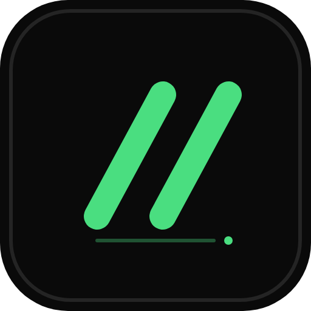
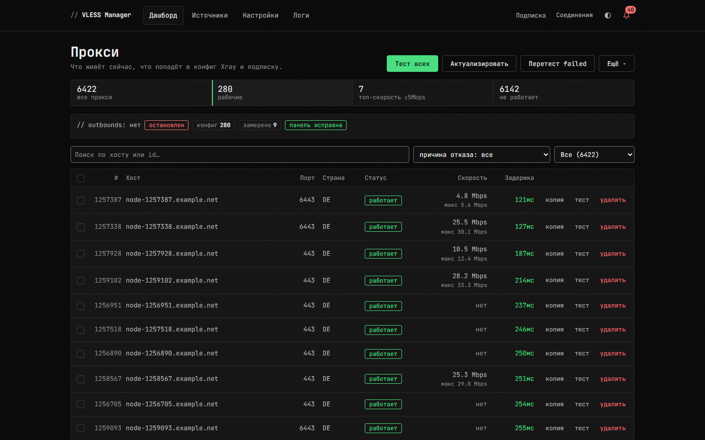

<p align="center">
  
</p>

<h1 align="center">VLESS Manager</h1>

<p align="center">
  <a href="LICENSE"></a>
  
  
  
</p>

> **v4.4.7** — финальный `apply_all(blocking=True)` ждёт lock не дольше 120 с и пишет WARN; частичный/пустой apply больше не считается успехом, а показывает «конфиг на диске новее Xray». В настройках видны desired/live/disk наборы outbound и расхождение; `apply_status` также в `/api/health`. **v4.4.6** — при падении профиля или неудачном замере скорости старые `speed_kbps`/`speed_max` сбрасываются; миграция v9 чистит устаревшие значения у уже упавших профилей. 20 — это лимит замеров **за прогон**, а не общее число замеренных; старые успешные замеры остаются у профилей, которые ещё не перепроверяли. **v4.4.5** — каталог файлов замера расширен: Cloudflare 10MB, `speedtest.wcloud.ru/10MB`, Google 100MB/10MB, HuggingFace; Drive оставлен последним, потому что может истечь.

Самостоятельная панель для VLESS-прокси. Проверяет узлы реальным запуском Xray, замеряет скорость, собирает конфиг Xray и `subscribe.txt` по одному правилу и применяет его через Xray API. Без облака и внешнего биллинга: SQLite, Flask, один процесс.



<sub>Страница источников — [docs/screens/sources.png](docs/screens/sources.png).</sub>

## Возможности

- **Одна пачка — один Xray** — профили проверяются одним процессом Xray со своим inbound на каждый; мёртвые адреса отсекает TCP-префильтр. Пинг снимается сразу, скорость — только у прошедших.
- **Тест лучших ссылок** — перед проверкой панель проверяет кандидатов URL пробы и берёт лучший; во время прогона чекер сам переключается на тот URL, который отвечает через туннели, и запоминает его. Живым считается HTTP-ответ с реальным телом; `403/404` от сервиса — да, пустой `200` или `5xx` без тела — нет.
- **Терпение к медленным узлам** — отдельные повторы пробы и TCP-префильтра с растущим таймаутом: серверы с защитой и медленным SYN не отсекаются с первой попытки.
- **Замер скорости** — файл `10MB` с Cloudflare; запасные: `speedtest.wcloud.ru`, Google `100MB`/`10MB`, HuggingFace, plain-HTTP CacheFly/bit.nl/Яндекс/Selectel. Фиксированное окно и два числа: **средняя** и **максимальная** скорость за 0.5 с. URL и запасные файлы настраиваются; при полном отказе в логе видна причина по каждому URL.
- **Диагностика скорости** — кнопка прямого замера панели (avg/max, без профиля) и замер через профиль. В тесте узла видно сравнение с последним прямым baseline; в настройках можно временно включить режим «только прямой», чтобы не обновлять скорости профилей.
- **Единая политика допуска** — конфиг и подписка собираются одним модулем `app/selection.py` и не могут разойтись.
- **Оценка источников** — 0–100, вердикты «основной», «мало рабочих», «все дубли», «нет ссылок» и рекомендация. Счётчики импорта показывают, сколько профилей новых, а сколько уже было в других источниках.
- **Импорт без сюрпризов** — понимает построчные ссылки, base64-подписки, HTML/JSON и `&amp;`; поддерживает транспорты `raw`, `httpupgrade`, `xhttp`; сетевой предохранитель проверяет, жива ли сеть, и не пропускает рабочие источники из-за пары заблокированных хостов.
- **Порты в UI** — SOCKS, HTTP и API Xray задаются в настройках (по умолчанию 1080/1081/10085). Смена портов пишется в конфиг; панель подсказывает, что нужен перезапуск демона.
- **Производительность** — по умолчанию 128 профилей на процесс Xray и отдельный пул TCP-префильтра (128 сокетов); домены в префильтре не резолвятся, их проверяет Xray. Значения меняются в «Проверка → Производительность».
- **Результат не ждёт конца прогона** — конфиг и подписка пересобираются сразу после проверки (если политика не требует замеров) и между замерами скорости: новые рабочие узлы появляются в течение десятков секунд, а не после всей стадии. Применение идёт через Xray API; если API недоступен — рестарт, если применить не удалось — в настройках явный статус «конфиг на диске новее Xray».
- **Понятная вёрстка настроек** — каждая строка это подпись слева, контрол справа и подсказка под ним; у секций есть заголовок и короткое «зачем это». Длинные подсказки больше не сжимаются в колонку по одной букве.
- **Актуализация** — перепроверяет только устаревшие и незамеренные профили, а не всю базу.
- **Наблюдаемость** — статусы Xray, логи, SSE-прогресс, уведомления, мобильные карточки и тёмная/светлая тема.

> Панель работает с VLESS/Xray. Hysteria2/TUIC и другие протоколы требуют отдельного ядра (sing-box) и в текущей проверке не участвуют.

## Как выбираются профили

Профиль попадает в конфиг и подписку, если:

1. `status=working` и `latency_vless > 0`;
2. ссылка валидна (UUID, порт, транспорт, reality publicKey);
3. страна не в блок-листе;
4. последний успешный тест не старше `profile_max_age_min`;
5. при `min_speed_mbps > 0` скорость замерена и не ниже порога;
6. при включённом «Только замеренные» (`require_speed`) обязателен `speed_kbps > 0`.

Сначала идут замеренные (по средней скорости), затем незамеренные — по качеству источника и пингу. Лимит — `max_active_proxies`.

Если строгий отбор не дал никого, включается явный fallback: медленные-но-замеренные → незамеренные → устаревшие. В режиме «Только замеренные» откат на незамеренные отключён: пустой конфиг лучше непроверенного. Fallback пишется в лог и виден в UI.

**Почему профиль не в конфиге** — блок «Состав конфига и подписки» на странице «Источники» или `GET /api/config/preview`: там есть `selected` и `excluded` с причинами.

## Быстрый старт

Нужны Linux, Python 3.10+ и Xray. Полная установка с systemd — в [docs/INSTALL.md](docs/INSTALL.md).

```bash
git clone https://github.com/prasx/vless-manager-proxy.git
cd vless-manager-proxy
python3 -m venv venv
source venv/bin/activate
pip install -r requirements.txt
python app.py
```

Открыть `http://<ip>:5000`. База `proxies.db` и кеш подписки создаются автоматически.

Для боевого запуска с Xray и systemd используй [docs/INSTALL.md](docs/INSTALL.md). Готовый `vless-manager.service` в корне рассчитан на `/opt/vless-manager` (venv внутри проекта).

Если импорт источников работает только через прокси, задайте `IMPORT_PROXY=socks5://127.0.0.1:1080` в окружении сервиса.

## Настройки

Основные параметры — в разделе «Настройки»:

| Ключ | По умолчанию | Что делает |
|------|--------------|------------|
| `xray_config_path` | `/etc/xray/config.json` | Куда панель пишет конфиг Xray |
| `socks_port` / `http_port` / `api_port` | `1080` / `1081` / `10085` | Порты inbound'ов и API Xray (задаются в UI) |
| `max_active_proxies` | `30` | Сколько лучших попадает в конфиг и подписку |
| `min_speed_mbps` | `0` | Минимальная скорость; незамеренный порог не подтверждает |
| `require_speed` | `false` | Только замеренные, без fallback на незамеренные |
| `speed_use_profiles` | `true` | Замер через профили; выключено — только прямой baseline панели (диагностика) |
| `speed_stage_budget_sec` | `1200` | Бюджет стадии скорости; после него остальные профили пропускаются |
| `profile_max_age_min` | `0` (авто) | Свежесть успешного теста: 2 интервала проверки, 3 ч–сутки |
| `probe_url` | Cloudflare `generate_204` | URL проверки узлов; подбирается тестом кандидатов |
| `probe_url_candidates` | пусто (встроенный каталог) | Свои кандидаты URL пробы: JSON-массив или строки |
| `probe_timeout` | `8` | Таймаут одной пробы, сек (медленные узлы) |
| `probe_retries` | `1` | Доп. попытки пробы с другим URL и большим таймаутом |
| `check_batch_size` | `128` | Профилей в одном процессе Xray за раз (4–256) |
| `tcp_prefilter_timeout` | `3` | Таймаут TCP-префильтра, сек |
| `tcp_prefilter_retries` | `1` | Повторы TCP-префильтра для медленного SYN |
| `tcp_prefilter_workers` | `128` | Параллельных TCP-проверок до запуска Xray (4–512) |
| `speed_test_url` | Cloudflare 10MB | Файл замера скорости |
| `speed_test_url_candidates` | пусто (встроенный каталог) | Свои файлы замера: JSON-массив или строки |
| `speed_test_max` | `8` | Сколько лучших по пингу профилей мерить за прогон |
| `speed_test_min_sec` | `10` | Окно замера одного профиля, сек |
| `probe_url_auto` | `true` | Автоподбор URL пробы по результатам теста |
| `safe_only_import` | `false` | Пропускать `security=none` при импорте |
| `blocked_countries` | пусто | Страны, исключённые из конфига и подписки |

Проверить и выбрать URL можно кнопкой «Тест URL» в настройках (или
`POST /api/urls/test`): панель тестирует кандидатов и применяет лучшего.

Полный список и значения по умолчанию — в `app/db.py` (`SETTING_DEFAULTS`).

## API и устройство

- REST API: [docs/API.md](docs/API.md). Для подписки — `GET /api/subscribe.txt`, для проверки состава — `GET /api/config/preview`.
- Точка входа — `app.py`; создание Flask-приложения — `app/__init__.py`; БД и миграции — `app/db.py`.
- Проверка и замеры — `app/proxy_manager.py` и `app/checker.py`; каталог и тест URL проверки — `app/netcheck.py`; политика отбора — `app/selection.py`; оценка источников — `app/source_quality.py`.
- Генерация конфига и Xray API — `app/xray_configurator.py`; импорт — `app/importer.py`; подписка — `app/subscribe.py`.
- Весь UI — `templates/` и `static/` (`style.css` — один файл токенов и компонентов).

## Тесты

Тесты не требуют Xray и сети: вместо процесса используется фейковый launcher, БД подменяется временным файлом.

```bash
python -m unittest discover -s tests -v
```

Покрыты батч-чекер, TCP-префильтр, backoff и due-выборка, политика допуска, подписка, качество источников, API-смоук, разбор «грязных» ссылок (HTML/base64/`&amp;`/`raw`), подбор лучшего URL проверки и миграции.

## Лицензия

MIT. См. [LICENSE](LICENSE).
